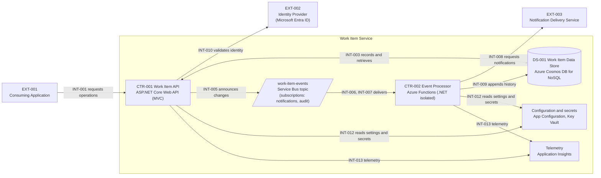
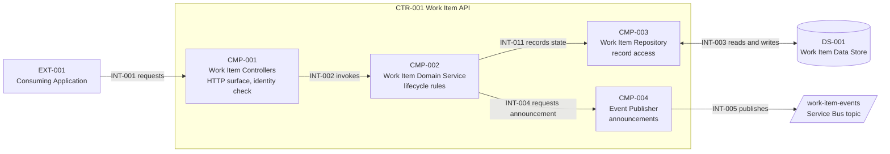

# Work Item Service Architecture Specifications

## Specifications Summary

The Work Item Service is split into two deployable containers. The **Work Item API** (CTR-001) is a stateless ASP.NET Core Web API using MVC controllers. It enforces the work item lifecycle, records state in the work item data store (DS-001), and announces each recorded change as an event. The **Event Processor** (CTR-002) is a set of Azure Functions that react to those events independently, one to request notifications and one to record history. Events travel through a single Azure Service Bus topic, `work-item-events`, with one subscription per reaction. Work items and their history are stored in Azure Cosmos DB for NoSQL (DS-001), and history entries are made safe to repeat by a unique key on the event identifier (OBL-013, OBL-014).

The most significant obligations are: every request is authenticated with Microsoft Entra ID (OBL-001); state is recorded before it is announced (OBL-002); delivery is at-least-once, so every reaction is idempotent (OBL-003); failed messages are never silently dropped (OBL-009); and workloads use managed identities rather than stored credentials (OBL-006). Service-level targets are in Cross-Cutting Architectural Constraints.

## Purpose and Scope

This document defines the component-level architecture and implementation boundaries of the Work Item Service. It supports Phase 5 implementation planning and the Infrastructure Architecture Guide. It is not a complete implementation design, an interface contract, or a deployment specification.

**Out of scope for this service:** the user interface; delivery of notification messages (provided by the Notification Delivery Service); and an API management gateway.

### Upstream Sources and Scope

| Source | Reference/Revision | Relevant scope or driver |
|--------|----------------------|--------------------------|
| Architecture Guide | [architecture-guide.md](architecture-guide.md), 1.1 | Principles P-1 to P-6; drivers D-1 to D-5 |
| System Context & Logical Components | [system-context.md](system-context.md), 1.1 | Boundary, external actors EXT-001 to EXT-004, responsibilities LR-001 to LR-004 |
| Executive Summary | [executive-summary.md](executive-summary.md), 1.1 | Business outcomes and conditions that motivate the drivers |
| Process Flow | [process-flow-work-item-creation-and-assignment.md](process-flow-work-item-creation-and-assignment.md), 1.1 | Runtime behavior the components must support |

This package does not include Non-Goals & Guardrails, ADR, risk, or assumption registers. Design decisions are recorded here as obligations, and unresolved items are tracked under Open Items and Evidence Gaps.

## Architecture Drivers and Traceability

The System Context ownership alignment is approved, so every responsibility ID is mapped.

| Driver/ Responsibility ID | Authoritative source | Concern or responsibility | Related component(s) / obligation(s) | Disposition or open gap |
|-----------------------------|----------------------|----------------------------|--------------------------------------|-------------------------|
| LR-001 | [system-context.md](system-context.md), Responsibility Inventory | Work Item Management | CMP-001, CMP-002, CMP-003, DS-001; OBL-001, OBL-005, OBL-012, OBL-013 | Mapped (1:many) |
| LR-002 | [system-context.md](system-context.md), Responsibility Inventory | Change Announcement | CMP-004; OBL-002, OBL-003, OBL-004 | Mapped; OI-002 open |
| LR-003 | [system-context.md](system-context.md), Responsibility Inventory | Notification | CMP-005; OBL-003, OBL-004, OBL-009 | Mapped |
| LR-004 | [system-context.md](system-context.md), Responsibility Inventory | History Recording | CMP-006, DS-001; OBL-003, OBL-004, OBL-009, OBL-013, OBL-014 | Mapped (1:many) |
| D-1 | [architecture-guide.md](architecture-guide.md), Drivers | Reuse across many applications | CMP-001; OBL-011 | Mapped; contracts open (OI-001) |
| D-2 | [architecture-guide.md](architecture-guide.md), Drivers | Responsive callers despite follow-on work | CMP-004 to CMP-006; Q-003 | Mapped |
| D-3 | [architecture-guide.md](architecture-guide.md), Drivers | Trustworthy history | CMP-004, CMP-006; OBL-002, OBL-003 | Mapped; OI-002 open |
| D-4 | [architecture-guide.md](architecture-guide.md), Drivers | Fast, repeatable environments | Realized in [infrastructure-architecture-guide.md](infrastructure-architecture-guide.md) | Mapped (N/A for components) |
| D-5 | [architecture-guide.md](architecture-guide.md), Drivers | Operable by a small team | OBL-007, OBL-009; Q-001 | Mapped; OI-003 open |

## Component Decomposition

Two deployable containers host six logical components, and the service owns one data store.

| Container | Technology (binding; see Technology Constraints) | Hosts |
|---|---|---|
| CTR-001 Work Item API | ASP.NET Core Web API with MVC controllers on .NET 10, in a container | CMP-001, CMP-002, CMP-003, CMP-004 |
| CTR-002 Event Processor | Azure Functions, .NET isolated worker, Flex Consumption plan | CMP-005, CMP-006 |

| Data store | Technology (binding; see Technology Constraints) | Holds |
|---|---|---|
| DS-001 Work Item Data Store | Azure Cosmos DB for NoSQL; database `workitems` | Container `work-items` (partition key `/workItemId`) holds work item records. Container `work-item-history` (partition key `/workItemId`, unique key `/eventId`) holds history entries. Accessed only through CMP-003 (records) and CMP-006 (history) |

| Component | Responsibility and boundary | Related upstream responsibility ID(s) | Source reference |
|-----------|-----------------------------|----------------------------------------|------------------|
| CMP-001 Work Item Controllers | The HTTP surface: receives requests, verifies caller identity, validates request shape, and maps results to responses. Contains no lifecycle rules. | LR-001 | [system-context.md](system-context.md), LR-001 |
| CMP-002 Work Item Domain Service | The lifecycle rules: valid states and transitions, and the decision that a change is allowed. Calls CMP-003 to record state and CMP-004 to announce. | LR-001 | [system-context.md](system-context.md), LR-001 |
| CMP-003 Work Item Repository | The only component that reads and writes work item records. Hides the data store behind an abstraction. | LR-001 | [system-context.md](system-context.md), LR-001 |
| CMP-004 Event Publisher | Builds and sends one announcement per recorded state change, with a unique event identifier and an event type. | LR-002 | [system-context.md](system-context.md), LR-002 |
| CMP-005 Notification Handler | Handles announcements on the `notifications` subscription and requests delivery of a notification. Idempotent. | LR-003 | [system-context.md](system-context.md), LR-003 |
| CMP-006 Audit Handler | Handles announcements on the `audit` subscription and appends a history entry. Idempotent. | LR-004 | [system-context.md](system-context.md), LR-004 |

### Architecture View

The container view shows the two deployable containers, the messaging backbone, and the supporting platform services. The component view shows the inside of the Work Item API, the only container hosting more than two components. Both views are drawn from the inventories above, using C4 container and component semantics in Mermaid flowchart notation.

**Legend:** Boxes outside the boundary are external systems. Boxes inside the boundary are containers (deployable units) or platform services the containers depend on; the slanted box is a message topic and the cylinder is the data store. Arrows show the direction of initiation and carry the interaction ID from the inventory below.

**Legend:** Boxes inside the boundary are components of the Work Item API container. Outside boxes are an external system, the data store, or the topic. Arrows show the direction of initiation and carry the interaction ID from the inventory below.

## Interaction and Dependency Inventory

This is the canonical list of architecture-significant interactions. Diagram arrows are views of these rows. Interface schemas are owned by contracts that are not yet written (OI-001).

| Interaction | Source | Target | Architectural purpose / direction | Protocol or constraint, if sourced | Contract / evidence reference |
|-------------|--------|--------|------------------------------------|------------------------------------|-------------------------------|
| INT-001 | EXT-001 Consuming Application | CMP-001 | Request, then response | HTTPS; JSON request and response bodies | OI-001 (API contract) |
| INT-002 | CMP-001 | CMP-002 | In-process call to apply a request | In-process | n/a |
| INT-003 | CMP-003 | DS-001 Work Item Data Store | Record and retrieve work item records | Azure Cosmos DB for NoSQL; managed identity access (OBL-006, OBL-013) | [infrastructure-architecture-guide.md](infrastructure-architecture-guide.md), section 6.2 |
| INT-004 | CMP-002 | CMP-004 | In-process request to announce a recorded change | In-process; after state is recorded (OBL-002) | n/a |
| INT-005 | CMP-004 | `work-item-events` topic | Announce a recorded change | Azure Service Bus topic; event type carried as a message property (OBL-004) | OI-001 (event contract) |
| INT-006 | `work-item-events` topic | CMP-005 | Deliver announcements of interest to notification | `notifications` subscription | OI-001 |
| INT-007 | `work-item-events` topic | CMP-006 | Deliver every announcement to history recording | `audit` subscription | OI-001 |
| INT-008 | CMP-005 | EXT-003 Notification Delivery Service | Request delivery of a notification | Interface owned by the Notification Delivery Service (OI-004) | OI-004 |
| INT-009 | CMP-006 | DS-001 Work Item Data Store | Append a history entry, using the event identifier as a unique key | Azure Cosmos DB for NoSQL; managed identity access (OBL-006, OBL-014) | [infrastructure-architecture-guide.md](infrastructure-architecture-guide.md), section 6.2 |
| INT-010 | CTR-001 | EXT-002 Identity Provider | Verify bearer tokens issued by Microsoft Entra ID | OAuth 2.0 bearer tokens (OBL-001) | n/a |
| INT-011 | CMP-002 | CMP-003 | In-process call to record or load state | In-process | n/a |
| INT-012 | CTR-001, CTR-002 | App Configuration, Key Vault | Read settings; resolve secret values | Managed identity access (OBL-006) | [infrastructure-architecture-guide.md](infrastructure-architecture-guide.md), section 5.4 |
| INT-013 | CTR-001, CTR-002 | Application Insights | Emit traces, metrics, and logs | OBL-007 | [infrastructure-architecture-guide.md](infrastructure-architecture-guide.md), section 6.6 |
| INT-014 | EXT-004 Service Operator | `audit` and `notifications` dead-letter areas | Review and resolve failed messages | Operator access by role | [process-flow-work-item-creation-and-assignment.md](process-flow-work-item-creation-and-assignment.md), Error Handling |

## Architectural Obligations and Implementation Freedom

| ID | Classification | Obligation, guidance, or reference | Basis / authoritative source | Scope / affected component(s) | Allowed variation or verification |
|----|----------------|------------------------------------|------------------------------|-------------------------------|----------------------------------|
| OBL-001 | Must | Every request except the health probe must carry a valid Microsoft Entra ID bearer token. Anonymous access is limited to the health probe. | Principle P-4; Lead Architect approval | CMP-001 | Verification: automated test that unauthenticated calls are rejected |
| OBL-002 | Must | A state change is recorded in the data store before it is announced. | Principle P-1; Lead Architect approval | CMP-002, CMP-004 | Verification: integration test |
| OBL-003 | Must | Delivery is at-least-once. Every handler is idempotent, using the event identifier to detect repeats. | Principle P-3; Lead Architect approval | CMP-005, CMP-006 | Verification: test that replays the same event |
| OBL-004 | Must | All announcements use one Service Bus topic, `work-item-events`, and carry an `eventType` message property. Subscription `notifications` receives only `WorkItemAssigned` and `WorkItemCompleted`; subscription `audit` receives all events. | Principle P-2; Lead Architect approval | CMP-004, CMP-005, CMP-006 | Verification: infrastructure plan review; integration test |
| OBL-005 | Must | The lifecycle states are New, Assigned, InProgress, Completed, and Cancelled. The event types are `WorkItemCreated`, `WorkItemAssigned`, `WorkItemStatusChanged`, and `WorkItemCompleted`. | Lead Architect approval; [process-flow-work-item-creation-and-assignment.md](process-flow-work-item-creation-and-assignment.md) | CMP-002, CMP-004 | Allowed: additional states or event types through a new revision |
| OBL-006 | Must | Workloads authenticate to Azure services, including the data store, with managed identities. No connection strings, keys, or passwords are stored in code or configuration where a managed identity can be used. Secret values that remain are held in Key Vault. | Principle P-4; Lead Architect approval | CTR-001, CTR-002 | Verification: configuration review; infrastructure plan review |
| OBL-007 | Must | Telemetry is correlated end to end using W3C trace context, carried from the API request into the announcement and every reaction. | Principle P-6; Lead Architect approval | CTR-001, CTR-002 | Verification: trace for one request shows API and handler spans |
| OBL-008 | Should | Application settings are read from App Configuration, with a label per environment, instead of being baked into images. | Principle P-5; Lead Architect approval | CTR-001, CTR-002 | Deviation allowed with stated rationale |
| OBL-009 | Must | A message that cannot be processed is retried up to 10 delivery attempts and then moved to the dead-letter area. Messages are never silently discarded. | Principle P-6; Lead Architect approval | CMP-005, CMP-006 | Verification: failure injection test |
| OBL-010 | May | The two handlers may be split into separate Function apps if scale or failure isolation requires it. | Lead Architect approval | CTR-002 | Any split must keep OBL-004 and OBL-009 |
| OBL-011 | Reference | Request and response schemas and event payloads are owned by the API contract and event contract (not yet written). | OI-001 | CMP-001, CMP-004 | n/a |
| OBL-012 | Must | The Work Item API is stateless. No request depends on in-memory state from a previous request. | Principle P-1; Lead Architect approval | CTR-001 | Verification: design review; scale-out test |
| OBL-013 | Must | Work items and their history are stored in Azure Cosmos DB for NoSQL, in database `workitems`. Container `work-items` holds work item records and container `work-item-history` holds history entries. Both are partitioned by `workItemId`, so all records of one work item are stored together. | Principle P-1; Lead Architect approval | CMP-003, CMP-006, DS-001 | Verification: infrastructure plan review |
| OBL-014 | Must | A history entry carries the event identifier, and the history container enforces its uniqueness, so a repeated announcement cannot create a second entry. | Principle P-3; Lead Architect approval | CMP-006, DS-001 | Verification: test that replays the same event |

## Cross-Cutting Architectural Constraints

All measures apply to the production environment unless stated.

| Concern / scenario | Context or stimulus | Affected component(s) | Required architectural response | Measure / source | Authoritative detail reference |
|--------------------|---------------------|-----------------------|---------------------------------|------------------|-------------------------------|
| Q-001 Availability | Normal operation over a calendar month | CTR-001 | The API remains reachable and serves requests | At least 99.9% monthly availability measured at the API ingress | [infrastructure-architecture-guide.md](infrastructure-architecture-guide.md), IG-013 |
| Q-002 Recovery | Accidental deletion or corruption of work item data, or loss of the deployed infrastructure, within the Azure region | CTR-001, CTR-002, DS-001 | Infrastructure is recreated from its declaration and work item data is restored to a point in time from continuous backup | RTO 4 hours; RPO 15 minutes. Loss of the whole Azure region is not covered: the service is single-region | [infrastructure-architecture-guide.md](infrastructure-architecture-guide.md), IG-014, IG-022 |
| Q-003 Reaction timeliness | A recorded change is announced | CMP-005, CMP-006 | Reactions run without the caller waiting | At least 95% of announcements handled within 60 seconds of being sent, steady state | [infrastructure-architecture-guide.md](infrastructure-architecture-guide.md), IG-015 |
| Q-004 Read responsiveness | Steady request load | CTR-001 | Single-item reads are served quickly | 95th percentile at most 300 ms at the API ingress under 50 requests per second | [infrastructure-architecture-guide.md](infrastructure-architecture-guide.md), IG-005 |

Boundary reminders: this document owns the service-level targets above. The Infrastructure Architecture Guide documents how the infrastructure realizes them. User journeys and contracts are not part of this package.

## Technology Constraints

The following technologies are binding for this service.

| Technology / standard | Binding scope and constraint | Classification | Approved ADR / source | Permitted variation |
|-----------------------|------------------------------|----------------|-----------------------|---------------------|
| ASP.NET Core Web API with MVC controllers (.NET 10) | Implementation of CTR-001 | Must | Lead Architect approval; no ADR in this package | Patch and minor versions only |
| Azure Container Apps | Hosting of CTR-001 | Must | Lead Architect approval | None stated |
| Azure Functions, Flex Consumption plan, .NET isolated | Hosting of CTR-002 | Must | Lead Architect approval | Runtime version follows .NET LTS |
| Azure Service Bus (topic and subscriptions) | Messaging backbone; Standard tier | Must | Lead Architect approval | None stated |
| Azure Cosmos DB for NoSQL | Work item data store DS-001; one account with database `workitems` | Must | Lead Architect approval | Capacity mode and backup retention are set in the Infrastructure Architecture Guide |
| Microsoft Entra ID | Caller and workload identity | Must | Lead Architect approval | None stated |
| Azure App Configuration, Azure Key Vault | Settings and secret values | Must | Lead Architect approval | None stated |
| Azure Application Insights on Azure Log Analytics | Telemetry | Must | Lead Architect approval | None stated |
| Terraform with the azurerm provider | Declaring and provisioning infrastructure | Must | Lead Architect approval; see [infrastructure-architecture-guide.md](infrastructure-architecture-guide.md) | Generated configuration only (IG-017) |

## Open Items and Evidence Gaps

| Item | Missing decision or evidence | Owner role | Target phase / review | Impact if unresolved |
|------|------------------------------|------------|-----------------------|-----------------------|
| OI-001 | API contract and event contract (request, response, and event payload schemas) | Lead Developer | Phase 5, before first release | Consumers cannot integrate; handlers cannot be built |
| OI-002 | Whether to guarantee announcement of every recorded change (for example an outbox pattern) or accept rare, logged gaps repaired by an operator | Lead Architect | Phase 5, before first release | History and notifications may miss a change in rare failures |
| OI-003 | Network isolation (private endpoints and virtual network integration) for production | Security Architect | Before production go-live | Platform services are reachable on public endpoints, protected only by identity controls |
| OI-004 | Interface and onboarding for the Notification Delivery Service | Integration Lead | Phase 5, before first release | CMP-005 cannot request deliveries |
| OI-005 | Whether serverless capacity mode remains appropriate for the Cosmos DB account in production, or provisioned throughput is needed | Lead Architect | Before production go-live | Throughput limits or usage-based cost may not suit production load |

## Related Authoritative Artifacts

- **[Architecture Guide](architecture-guide.md)** - System narrative, vision, and architecture drivers.
- **[System Context & Logical Components](system-context.md)** - System boundary and high-level responsibilities.
- **[Process Flow](process-flow-work-item-creation-and-assignment.md)** - Runtime behavior of creation, assignment, and reactions.
- **[Infrastructure Architecture Guide](infrastructure-architecture-guide.md)** - Infrastructure topology, realization of the quality targets, and the build contract for the infrastructure specification.
- **[Executive Summary](executive-summary.md)** - Recommendation, current ask, and business outcomes.
