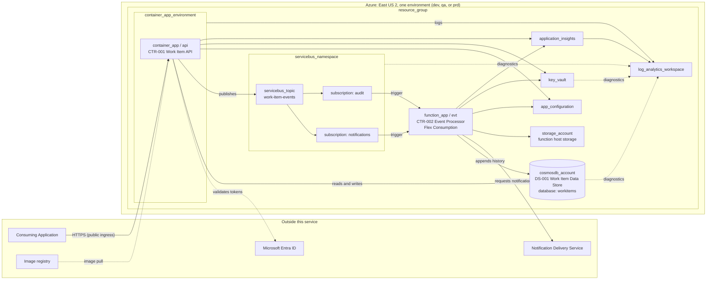

# Infrastructure Architecture Guide: Work Item Service

## 1. Document Control and Authority

- **Purpose and decision scope:** The infrastructure that hosts the Work Item Service in the dev, qa, and prd environments: what must be built, reused, or supplied externally, how workloads map to it, and the binding constraints on how it is realized.
- **Owner:** Platform Engineering Lead
- **Status and revision:** Approved; revision 1.1
- **Applicable hosting models and environments:** Microsoft Azure public cloud, single region (East US 2), managed platform services only. Environments: dev, qa, prd. On-premises, hybrid, and edge hosting are not applicable.
- **Change trigger:** Material architecture changes listed in Section 12.
- **Companion infrastructure specification:** `work-item-service.infra.yaml`. It is generated from this guide as the first step of infrastructure delivery and is not yet generated.
- **Generator and module baseline:** The PowerShell Terraform generator and the azurerm provider (4.x) it targets. The exact revision is recorded in Section 10 once the specification has been generated.
- **Authority note:** This guide owns the readable infrastructure architecture and build scope. The companion infrastructure specification (YAML) owns generator inputs. Generated and reviewed Terraform owns declared configuration. Azure owns realized state.

## 2. Purpose, Scope, and Reader Outcomes

### Purpose and scope

This guide defines the infrastructure for the Work Item Service described in [System Context & Logical Components](system-context.md) and [Architecture Specifications](architecture-specifications.md). It covers the Azure resources for the two containers CTR-001 (Work Item API) and CTR-002 (Event Processor), the messaging backbone, and supporting configuration, secret, and telemetry services.

### Readers and outcomes

| Reader | What the reader should be able to determine |
|---|---|
| Platform engineer | Which resources to build, how they relate, and which constraints bind the configuration |
| Developer | Where each component runs and how it reaches platform services |
| Architect or ARB reviewer | How the quality targets are realized and which decisions are deferred |
| Security reviewer | The trust boundaries, identity model, and deferred network isolation |
| Infrastructure specification author (human or AI) | The complete build scope needed to write the companion YAML |

### Out of scope

- Service-level quality targets ([Architecture Specifications](architecture-specifications.md), Q-001 to Q-004).
- The container image registry, identity provider tenant, and Terraform state storage. These are supplied externally (Section 5.1, IG-019).
- An API management gateway. It is not part of this service.
- Exhaustive resource settings, runbooks, alert thresholds, and live cost.

## 3. Authoritative Inputs and Referenced Standards

| Source or standard | Version/revision | Authority and scope used here | Link |
|---|---|---|---|
| Architecture Specifications | 1.1 | Quality targets Q-001 to Q-004 and obligations OBL-001 to OBL-012 realized here | [architecture-specifications.md](architecture-specifications.md) |
| System Context & Logical Components | 1.1 | External systems EXT-001 to EXT-004 and boundary | [system-context.md](system-context.md) |
| Architecture Guide | 1.1 | Principles P-4 (identity over secrets), P-5 (reproducible by design), P-6 (observable by default) | [architecture-guide.md](architecture-guide.md) |
| Executive Summary | 1.1 | Two working-day target for a ready development environment | [executive-summary.md](executive-summary.md) |
| Enterprise or platform standard | Not applicable | No enterprise standard applies to this service. Naming, tagging, and region conventions are defined in this guide (IG-001 to IG-003). | n/a |

## 4. Infrastructure Architecture Summary

Each environment is a single Azure resource group in East US 2 that contains everything the service owns. The Work Item API runs as an Azure Container App in a Container Apps environment. The Event Processor runs as an Azure Function on the Flex Consumption plan. A Service Bus namespace carries one topic, `work-item-events`, with two subscriptions that feed the two reactions. App Configuration holds settings, Key Vault holds secret values, and Application Insights on a Log Analytics workspace collects telemetry. An Azure Cosmos DB for NoSQL account holds work items and their history.

Workloads use system-assigned managed identities and Azure role-based access control. Local keys and connection strings are disabled where the platform allows. The container image registry, the identity tenant, and Terraform state storage are supplied outside this service. Network isolation is deferred (IG-016). All infrastructure is declared in a companion YAML specification and generated into Terraform deterministically (IG-017, IG-018).

## 5. Hosting and Deployment Views

### 5.1 Workload-to-infrastructure mapping

"Spec type" is the resource type name used in the companion infrastructure specification; "key" distinguishes more than one resource of the same type.

| Workload or logical element | Infrastructure role | Relationship and why needed | Provisioning responsibility | Environment applicability | Obligation IDs | Spec type / key or external design path |
|---|---|---|---|---|---|---|
| Environment boundary | Resource group | Contains every resource the service owns; unit of lifecycle and access | New | dev, qa, prd | IG-004 | `resource_group` |
| Log sink | Log Analytics workspace | Central destination for logs and the backing store for Application Insights | New | dev, qa, prd; retention differs (Section 7) | IG-011, IG-012 | `log_analytics_workspace` |
| Telemetry (INT-013) | Application Insights | Receives traces and metrics from CTR-001 and CTR-002, workspace-based | New | dev, qa, prd | IG-011 | `application_insights` |
| Settings (INT-012) | App Configuration | Holds per-environment settings read by both containers | New | dev, qa, prd; SKU differs | IG-008 | `app_configuration` |
| Secrets (INT-012) | Key Vault | Holds secret values referenced by settings | New | dev, qa, prd; purge protection differs | IG-010 | `key_vault` |
| Messaging backbone | Service Bus namespace | Hosts the announcement topic | New | dev, qa, prd | IG-007, IG-008 | `servicebus_namespace` |
| Announcements (INT-005) | Service Bus topic `work-item-events` | Single topic for all work item events | New | dev, qa, prd | IG-007 | `servicebus_topic` / `work-item-events` |
| Notification reaction input (INT-006) | Service Bus subscription `notifications` | Receives assigned and completed events | New | dev, qa, prd | IG-007 | `servicebus_subscription` / `notifications` |
| Audit reaction input (INT-007) | Service Bus subscription `audit` | Receives all events | New | dev, qa, prd | IG-007 | `servicebus_subscription` / `audit` |
| CTR-001 hosting environment | Container Apps environment | Shared hosting boundary for the API; sends logs to the workspace | New | dev, qa, prd | IG-005, IG-011 | `container_app_environment` |
| CTR-001 Work Item API | Container App | Runs the API container behind HTTPS ingress | New | dev, qa, prd; replicas differ | IG-005, IG-013 | `container_app` / `api` |
| CTR-002 Event Processor | Function App, Flex Consumption plan | Runs the two handlers; scales on message load | New; the plan is created with the app | dev, qa, prd; max instances differ | IG-006, IG-015 | `function_app` / `evt` |
| CTR-002 host storage | Storage account | Holds the Function App's deployment package and host state | New (supporting) | dev, qa, prd | IG-006, IG-008 | `storage_account` |
| DS-001 Work Item Data Store (INT-003, INT-009) | Cosmos DB account, NoSQL API | Holds work item records and history | New | dev, qa, prd; backup retention differs (Section 7) | IG-008, IG-022 | `cosmosdb_account` |
| DS-001 database `workitems` | Cosmos DB SQL database | Groups the two data containers | New | dev, qa, prd | IG-022 | `cosmosdb_sql_database` / `workitems` |
| DS-001 container `work-items` | Cosmos DB SQL container | Work item records | New | dev, qa, prd | IG-022 | `cosmosdb_sql_container` / `work-items` |
| DS-001 container `work-item-history` | Cosmos DB SQL container | History entries, unique by event identifier | New | dev, qa, prd | IG-022 | `cosmosdb_sql_container` / `work-item-history` |
| Container image registry | Image registry | Supplies the API image to the Container App | External: platform-provided | Shared | IG-019, IG-020 | External design path: Platform Engineering |
| EXT-002 Identity Provider | Microsoft Entra ID tenant and app registrations | Caller and workload identity | External: platform-provided | Shared | IG-019 | External design path: Platform Engineering |
| Terraform state | Remote state storage | Holds Terraform state per environment | External: platform-provided | Shared | IG-021 | External design path: Platform Engineering |
| EXT-003 Notification Delivery Service | Messaging service | Delivers notifications (INT-008) | External | n/a | IG-019 | Outside infrastructure scope (OI-004) |

### 5.2 C4 Deployment View and arc42 Deployment View

The deployment view shows the production-shaped baseline. Dev and qa have the same structure with the differences in Section 7, so no separate diagrams are drawn.

| View | Stakeholder concern and purpose | Environment/scope | Notation, element/relationship meanings, and legend | Spec identities represented | Source/revision |
|---|---|---|---|---|---|
| Deployment view (above) | Platform engineers and reviewers: where each workload runs and what it depends on | One environment; dev, qa, and prd share the structure | Mermaid flowchart with C4 deployment semantics. Nested boxes are deployment nodes. Labels name the spec type and key. Solid arrows are runtime calls, dotted arrows are identity validation, image pulls, or diagnostics. Elements in the "Outside this service" box are not provisioned by this specification | All types in Section 5.1 | This guide, 1.1 |

### 5.3 Boundaries, zones, sites, regions, and failure domains

- **Region:** every resource is in East US 2. There is no secondary region (IG-002, IG-014).
- **Environment boundary:** each environment is one resource group. Which Azure subscription each environment lands in is delegated (Section 9).
- **Trust boundary:** the Container App ingress is the only point reachable from outside Momentum Rocket Skates' applications. All Azure services in the diagram are reachable on public endpoints in this baseline and protected by identity (IG-008, IG-009). Private networking is deferred (IG-016, OI-003).
- **Failure domains:** a regional outage affects all resources, including the single-region Cosmos DB account. Zone redundancy is not a baseline obligation because Q-001 does not require it (Section 9). Precise IP allocation does not apply, because no virtual network is provisioned.

### 5.4 Connectivity, traffic, DNS, and trust boundaries

| Flow or boundary | Source to destination | Purpose/trust relationship | Obligation IDs | Detailed configuration authority |
|---|---|---|---|---|
| F-1 | Consuming Application to Container App | HTTPS only on the platform-assigned hostname; caller identified by token (INT-001) | IG-005, OBL-001 | Companion YAML and generated Terraform |
| F-2 | Container App to Entra ID | Token validation (INT-010) | OBL-001 | Application configuration |
| F-3 | Container App to Service Bus topic | Publish announcements, as managed identity (INT-005) | IG-007, IG-009 | Companion YAML and generated Terraform |
| F-4 | Service Bus subscriptions to Function App | Trigger the handlers, as managed identity (INT-006, INT-007) | IG-007, IG-009 | Companion YAML and generated Terraform |
| F-5 | Container App and Function App to App Configuration | Read settings, as managed identity (INT-012) | IG-009 | Companion YAML and generated Terraform |
| F-6 | Container App and Function App to Key Vault | Resolve secret values, as managed identity (INT-012) | IG-009, IG-010 | Companion YAML and generated Terraform |
| F-7 | Function App to its storage account | Deployment package and host state, as managed identity | IG-006, IG-009 | Companion YAML and generated Terraform |
| F-8 | Container App and Function App to Application Insights | Telemetry (INT-013) | IG-011 | Companion YAML and generated Terraform |
| F-9 | Container App and Function App to the Cosmos DB account | Records and history (INT-003, INT-009), as managed identity | IG-009, IG-022 | Companion YAML and generated Terraform |
| F-10 | Function App to Notification Delivery Service | Notification requests (INT-008) | IG-019 | Notification Delivery Service (OI-004) |

## 6. Infrastructure Architecture Obligations

| ID | Statement | Class | Applies to | Source/authority | Verification | Delegated decision and bounds |
|---|---|---|---|---|---|---|
| IG-001 | Resource names follow the pattern in Section 6.7. | MUST | All resources | Platform Engineering Lead; design baseline 1.0 | Generated names reviewed in the Terraform plan | N/A |
| IG-002 | All resources are in East US 2. | MUST | All resources | Platform Engineering Lead; design baseline 1.0 | Plan shows the region on every resource | N/A |
| IG-003 | Every resource that supports tags carries the tags in Section 6.7. | MUST | All resources | Platform Engineering Lead; design baseline 1.0 | Plan review; policy check where available | N/A |
| IG-004 | One resource group per environment contains every resource the service owns. | MUST | `resource_group` | Design baseline 1.0 | Plan shows all resources in one group | N/A |
| IG-005 | The API runs as a Container App with HTTPS-only external ingress, a single active revision, and the sizing in Section 6.1. It supports Q-004. | MUST | `container_app` / `api`; `container_app_environment` | [Architecture Specifications](architecture-specifications.md) CTR-001, Q-004 | Plan review; load test against Q-004 | N/A |
| IG-006 | The Event Processor runs as a Function App on the Flex Consumption plan (Linux, .NET isolated), using the host storage account for its deployment package. | MUST | `function_app` / `evt`; `storage_account` | [Architecture Specifications](architecture-specifications.md) CTR-002 | Plan review | N/A |
| IG-007 | The Service Bus namespace is Standard tier and contains one topic, `work-item-events`, with subscriptions `notifications` and `audit`, configured as in Section 6.2. | MUST | `servicebus_namespace`, `servicebus_topic`, `servicebus_subscription` | [Architecture Specifications](architecture-specifications.md) OBL-004, OBL-009 | Plan review; integration test | N/A |
| IG-008 | Local authentication (keys, SAS, connection strings, account keys) is disabled on Service Bus, App Configuration, and the Cosmos DB account, and shared key access is disabled on the storage account. | MUST | `servicebus_namespace`, `app_configuration`, `cosmosdb_account`, `storage_account` | [Architecture Specifications](architecture-specifications.md) OBL-006 | Plan shows the settings disabled | N/A |
| IG-009 | The Container App and Function App each use a system-assigned managed identity with the least-privilege roles in Section 6.3. | MUST | `container_app`, `function_app` | [Architecture Specifications](architecture-specifications.md) OBL-006 | Plan shows only the listed role assignments | N/A |
| IG-010 | Key Vault uses Azure role-based access control with soft delete retained for 90 days. Purge protection is enabled in prd only. | MUST | `key_vault` | Design baseline 1.0 | Plan review | N/A |
| IG-011 | Application Insights is workspace-based and linked to the Log Analytics workspace. The Container Apps environment sends its logs to the same workspace. Both containers receive the Application Insights connection string. | MUST | `application_insights`, `log_analytics_workspace`, `container_app_environment` | [Architecture Guide](architecture-guide.md) P-6; [Architecture Specifications](architecture-specifications.md) OBL-007 | Plan review; trace visible in Application Insights | N/A |
| IG-012 | Key Vault, the Service Bus namespace, and the Cosmos DB account send all log categories and all metrics to the Log Analytics workspace through diagnostic settings. | MUST | `key_vault`, `servicebus_namespace`, `cosmosdb_account` | [Architecture Guide](architecture-guide.md) P-6 | Plan shows a diagnostic setting for each | N/A |
| IG-013 | Realization of Q-001: in prd, the API has a minimum of 2 replicas. | TARGET | `container_app` / `api` | [Architecture Specifications](architecture-specifications.md) Q-001 | Availability measured at ingress | N/A |
| IG-014 | Realization of Q-002: all infrastructure can be recreated in an empty resource group from the companion specification, and work item data can be restored to a point in time from continuous backup (IG-022). | TARGET | All provisioned resources | [Architecture Specifications](architecture-specifications.md) Q-002 | Recreation and point-in-time restore exercise before production go-live | N/A |
| IG-015 | Realization of Q-003: the Function App scales out on message load up to the maximum instance count for its environment (Section 7). | TARGET | `function_app` / `evt` | [Architecture Specifications](architecture-specifications.md) Q-003 | Reaction timeliness measured in qa | N/A |
| IG-016 | Network isolation of platform services for prd is decided before production go-live. The Standard Service Bus tier does not support private endpoints, so the decision may change the tier. | DELEGATED | Service Bus, Key Vault, App Configuration, Cosmos DB, Storage, Function App, Container Apps environment | [Architecture Specifications](architecture-specifications.md) OI-003 | Decision recorded and reflected in this guide | Security Architect; bound: before production go-live |
| IG-017 | Infrastructure is provisioned only from Terraform generated from the companion specification. Changes made outside it are not permitted. | MUST | All provisioned resources | [Architecture Guide](architecture-guide.md) P-5 | A plan after apply shows no changes | N/A |
| IG-018 | Generation is deterministic: the same specification produces byte-identical Terraform on every run. | MUST | Generator and companion specification | [Architecture Guide](architecture-guide.md) P-5 | Generate twice and compare output | N/A |
| IG-019 | The image registry, identity provider tenant, and notification delivery service are external. This service consumes them and does not provision them. | REFERENCE | Section 5.1 external rows | [System Context & Logical Components](system-context.md) EXT-002 to EXT-003 | n/a | N/A |
| IG-020 | Scaling bounds and the container image reference may be tuned within the bounds in Sections 6.1 and 7 without a revision of this guide. | DELEGATED | `container_app`, `function_app` | Design baseline 1.0 | Change recorded in the companion specification | Platform Engineering Lead; bounds in Section 7 |
| IG-021 | The location and configuration of Terraform remote state is supplied by the platform. | DELEGATED | Terraform backend | Design baseline 1.0 | Backend configuration present for each environment | Platform Engineering Lead; before first apply |
| IG-022 | The Cosmos DB account uses the NoSQL API, serverless capacity mode, Session consistency, a single region, and continuous backup (retention per Section 7). It contains database `workitems` with containers `work-items` and `work-item-history` as in Section 6.2. | MUST | `cosmosdb_account`, `cosmosdb_sql_database`, `cosmosdb_sql_container` | [Architecture Specifications](architecture-specifications.md) OBL-013, OBL-014, Q-002 | Plan review; point-in-time restore exercise | N/A |

### 6.1 Compute and execution

| Element | Baseline configuration |
|---|---|
| Container Apps environment | Consumption workload profile only; logs sent to the Log Analytics workspace |
| Container App `api` | External ingress, target port 8080, HTTPS only; single active revision; 0.5 vCPU and 1 GiB memory; HTTP scaling rule at 50 concurrent requests per replica; system-assigned managed identity |
| Container App image | Initial image `mcr.microsoft.com/dotnet/samples:aspnetapp`, a placeholder that listens on port 8080. The delivery pipeline replaces it, so image changes are ignored by Terraform to avoid drift (IG-020) |
| Container App settings | `APPCONFIG_ENDPOINT`, `KEYVAULT_URI`, `APPLICATIONINSIGHTS_CONNECTION_STRING`, and `COSMOS_ENDPOINT`, populated from the corresponding resources |
| Function App `evt` | Flex Consumption (SKU FC1), Linux, .NET isolated runtime 10.0, 2048 MB instance memory; system-assigned managed identity |
| Function App settings | The same settings as the API, plus the Service Bus namespace endpoint and the host storage account name, populated from the corresponding resources |

### 6.2 Data, storage, messaging, and platform dependencies

| Element | Baseline configuration |
|---|---|
| Service Bus namespace | Standard SKU; minimum TLS 1.2; local authentication disabled |
| Topic `work-item-events` | Default message time-to-live 7 days; duplicate detection enabled with a 10-minute window |
| Subscription `notifications` | Maximum delivery count 10; lock duration 1 minute; dead-letter on message expiration; message time-to-live 7 days; rule: SQL filter `eventType IN ('WorkItemAssigned', 'WorkItemCompleted')` |
| Subscription `audit` | Maximum delivery count 10; lock duration 1 minute; dead-letter on message expiration; message time-to-live 7 days; rule: all messages |
| Storage account | StorageV2, Standard LRS, Hot tier; minimum TLS 1.2; shared key access disabled; blob public access disabled; one private blob container, `deployments`, for the Function App package |
| Cosmos DB account | NoSQL API; serverless capacity mode; Session consistency; single region (East US 2) with no zone redundancy; continuous backup (retention per Section 7); local (key) authentication disabled |
| Database `workitems` | No throughput settings, because the account is serverless |
| Container `work-items` | Partition key `/workItemId`; default indexing |
| Container `work-item-history` | Partition key `/workItemId`; unique key `/eventId`; default indexing |
| App Configuration | Local authentication disabled; SKU per Section 7 |

Work item records and history entries are stored as JSON documents. Their structure is owned by the data model, which is not part of this package. The API and handlers receive the account endpoint through the `COSMOS_ENDPOINT` setting (Section 6.1).

### 6.3 Identity, secrets, certificates, and infrastructure security

Role assignments follow the relationships in Section 5.4 and are derived from the specification. Exact assignments live in the companion YAML and generated Terraform.

| Relationship | Principal | Role | Scope |
|---|---|---|---|
| F-3 publish | API managed identity | Azure Service Bus Data Sender | Topic `work-item-events` |
| F-4 receive | Event Processor managed identity | Azure Service Bus Data Receiver | Topic `work-item-events` |
| F-5 settings | API and Event Processor managed identities | App Configuration Data Reader | App Configuration |
| F-6 secrets | API and Event Processor managed identities | Key Vault Secrets User | Key Vault |
| F-7 host storage | Event Processor managed identity | Storage Blob Data Owner | Storage account |
| F-9 data | API and Event Processor managed identities | Cosmos DB Built-in Data Contributor (data plane) | Database `workitems` |

The Terraform provider authenticates to storage data planes with Microsoft Entra ID so that shared key access can stay disabled. Human operator and developer access (for example, reviewing dead-lettered messages) is granted by the Platform Engineering Lead outside this specification (Section 9). Network isolation is deferred (IG-016). No certificates are managed by this specification.

### 6.4 Availability, resiliency, backup, and disaster recovery

- **Quality scenario / RTO / RPO target:** [Architecture Specifications](architecture-specifications.md), Q-001 and Q-002. This guide does not establish or override them.
- **Infrastructure realization:** the production API runs at least 2 replicas (IG-013). The service is single-region with no secondary deployment. Recovery is by recreating the declared infrastructure and restoring work item data to a point in time from continuous backup (IG-014, IG-022). Loss of the whole Azure region is not covered by Q-002.
- **Operational recovery procedures:** runbook; owner Platform Engineering Lead; before production go-live.

### 6.5 Capacity, scalability, and performance realization

The API scales by replica count between the minimum and maximum in Section 7, driven by concurrent requests (Q-004). The Event Processor scales on message load up to the instance maximum in Section 7 (Q-003). The Cosmos DB account runs in serverless capacity mode in every environment, so no throughput is provisioned; whether that remains appropriate for prd is an open item (OI-005). No capacity figures beyond the targets are asserted. Load testing evidence is produced in Phase 5.

### 6.6 Observability and operational capability

Both containers emit traces, metrics, and logs to Application Insights, which stores them in the Log Analytics workspace (IG-011). Key Vault and Service Bus diagnostics also flow to the workspace (IG-012). Trace correlation across the announcement is an application obligation ([Architecture Specifications](architecture-specifications.md), OBL-007). Dashboards, queries, alert thresholds, and notification routing are owned by operations and are not defined here (owner Platform Engineering Lead; Phase 5).

### 6.7 Naming and tagging reference

**Name pattern:** `{abbreviation}-mmtm-wis[-{component}]-{environment}-eus2`, using the abbreviations below. The storage account name omits hyphens: `stmmtmwis{environment}eus2`. The environment values are `dev`, `qa`, and `prd`.

| Resource | Abbreviation | Example (dev) |
|---|---|---|
| Resource group | `rg` | `rg-mmtm-wis-dev-eus2` |
| Log Analytics workspace | `log` | `log-mmtm-wis-dev-eus2` |
| Application Insights | `appi` | `appi-mmtm-wis-dev-eus2` |
| App Configuration | `appcs` | `appcs-mmtm-wis-dev-eus2` |
| Key Vault | `kv` | `kv-mmtm-wis-dev-eus2` |
| Service Bus namespace | `sbns` | `sbns-mmtm-wis-dev-eus2` |
| Container Apps environment | `cae` | `cae-mmtm-wis-dev-eus2` |
| Container App (component `api`) | `ca` | `ca-mmtm-wis-api-dev-eus2` |
| Function App (component `evt`) | `func` | `func-mmtm-wis-evt-dev-eus2` |
| Function hosting plan | `plan` | `plan-mmtm-wis-evt-dev-eus2` |
| Storage account | `st` | `stmmtmwisdeveus2` |
| Cosmos DB account | `cosmos` | `cosmos-mmtm-wis-dev-eus2` |

Topic, subscription, database, and container names are fixed (`work-item-events`, `notifications`, `audit`, `workitems`, `work-items`, `work-item-history`) and carry no environment suffix.

**Tags:**

| Tag | Value |
|---|---|
| `workload` | `work-item-service` |
| `environment` | `dev`, `qa`, or `prd` |
| `owner` | `platform-engineering` |
| `cost_center` | `digital-products` |
| `data_classification` | `internal` |
| `criticality` | `medium` |
| `managed_by` | `terraform` |

## 7. Environment and Deployment Variability

The architecture is identical in dev, qa, and prd. Only the following differ.

| Concern | Baseline | Material environment delta | Reason/source | Decision owner or obligation IDs |
|---|---|---|---|---|
| API replicas (minimum / maximum) | n/a | dev 0 / 2; qa 1 / 3; prd 2 / 10 | Dev scales to zero to limit cost; prd supports Q-001 | IG-013, IG-020 |
| Function maximum instance count | n/a | dev 40; qa 40; prd 100 | Q-003 matters most in prd | IG-015, IG-020 |
| Log Analytics retention | n/a | dev 30 days; qa 30 days; prd 90 days | Longer investigation window in prd | IG-011 |
| Key Vault purge protection | Disabled | prd enabled | Protect secrets from permanent deletion in prd | IG-010 |
| Cosmos DB continuous backup retention | 7 days | prd 30 days | Longer point-in-time restore window in prd, supporting Q-002 | IG-022 |
| App Configuration SKU | n/a | dev and qa `developer`; prd `standard` | Developer tier is not intended for production | IG-008 |
| Environment tag and name suffix | n/a | dev, qa, prd | Naming and tagging | IG-001, IG-003 |

## 8. Standards Applicability and Approved Exceptions

| Standard/control | Authority and version | Applicability to this solution | Approved exception and decision reference |
|---|---|---|---|
| Enterprise cloud platform standard | None applies to this service | Not applicable. Conventions for naming, tagging, and region are defined in IG-001 to IG-003. | N/A |

## 9. Implementation Freedom and Deferred Decisions

| Decision or freedom | Class | Authorized decision role | Boundaries/evidence | Owner and resolution point |
|---|---|---|---|---|
| Network isolation for prd (IG-016, OI-003) | DELEGATED | Security Architect | Must be decided before production go-live; may change the Service Bus tier | Security Architect; before production go-live |
| Azure subscription for each environment | DELEGATED | Platform Engineering Lead | One resource group per environment (IG-004) | Platform Engineering Lead; before first apply |
| Terraform remote state location (IG-021) | DELEGATED | Platform Engineering Lead | State is separate per environment | Platform Engineering Lead; before first apply |
| Container image reference and replica / instance values | DELEGATED | Platform Engineering Lead | Bounds in Sections 6.1 and 7 | Platform Engineering Lead; ongoing |
| Zone redundancy | DELEGATED | Lead Architect | Not required to meet Q-001 on current evidence; revisit if Q-001 changes | Lead Architect; Phase 5 |
| Operator and developer access assignments | DELEGATED | Platform Engineering Lead | Least privilege; outside this specification | Platform Engineering Lead; before qa |
| Cosmos DB capacity mode for prd (OI-005) | DELEGATED | Lead Architect | Serverless is the baseline in every environment; revisit before production go-live | Lead Architect; before production go-live |

## 10. Authoritative Implementation and Operational Sources

| Concern | Authority for design, declared configuration, or observed state | Revision/as-of reference | Link |
|---|---|---|---|
| Generator inputs | Companion infrastructure specification `work-item-service.infra.yaml` | Not yet generated; revision recorded at generation | Link recorded at generation; owner Platform Engineering Lead |
| Generator schema and resource behavior | PowerShell Terraform generator | Revision recorded at generation; azurerm provider 4.x | Link recorded at generation; owner Platform Engineering Lead |
| Generated / declared infrastructure | Generated and subsequently reviewed Terraform | Not yet generated | Link recorded at generation |
| Generation and validation evidence | Generation, `terraform validate`, and plan checks | Not yet run; no check is claimed to have passed | Results recorded at generation |
| Infrastructure not represented by the specification | Platform Engineering (registry, identity, state) | As owned by each team | See Section 5.1 external rows |
| Realized infrastructure state | Azure resource inventory | Not yet provisioned | As-of date recorded after first apply |
| Network / IP allocation | Not applicable; no virtual network is provisioned | n/a | n/a |
| Security and monitoring configuration | Companion specification and generated Terraform for this service; operations for dashboards and alerts | Not yet generated | Recorded at generation |
| FinOps forecast / actuals | Finance Business Partner | Estimate in [executive-summary.md](executive-summary.md) | [executive-summary.md](executive-summary.md) |
| Operational procedures | Operations runbooks | Not yet written | Owner Platform Engineering Lead; before production go-live |

## 11. Traceability and Related Evidence

| Evidence | Relevant IDs/sections | Relationship to this guide |
|---|---|---|
| System Context | EXT-001 to EXT-004; [system-context.md](system-context.md) | Boundary and external relationships; EXT-002 to EXT-003 are external here |
| Architecture Specifications and quality scenarios | Q-001 to Q-004, OBL-001 to OBL-012, INT-001 to INT-014, OI-001 to OI-005; [architecture-specifications.md](architecture-specifications.md) | Requirements realized here |
| Architecture Guide | P-4, P-5, P-6, D-4; [architecture-guide.md](architecture-guide.md) | Principles that drive identity, reproducibility, and observability obligations |
| Executive Summary | Two working-day environment target; [executive-summary.md](executive-summary.md) | Delivery expectation for the build |
| Process Flow | [process-flow-work-item-creation-and-assignment.md](process-flow-work-item-creation-and-assignment.md) | Behavior that the messaging topology supports |
| Companion specification, generated Terraform, validation evidence | Section 10 | Generator inputs, declared configuration, and verification (not yet produced) |
| External or shared infrastructure design | Registry, identity, state | Infrastructure not provisioned by this specification (IG-019) |
| Operations sources | Section 10 | Operational authority |

## 12. Review and Change Triggers

Review this guide when a material change affects:

- Topology, placement, hosting boundaries, or major infrastructure dependencies.
- Trust boundaries, failure domains, or architecture-significant connectivity (including a decision on IG-016).
- Binding infrastructure obligations or their verification.
- Material environment differences or an approved standards exception.
- A governing Architecture Specification or other decision linked by this guide.

Routine implementation and configuration changes, and changing live inventory, belong in their authoritative sources.

| Review record | Date | Reviewer role | Material change or outcome | Related decision/evidence |
|---|---|---|---|---|
| Phase 3 initial review | 2026-10-09 | Platform Engineering Lead; Lead Architect | Guide drafted from Architecture Specifications 1.0; network isolation deferred | [architecture-specifications.md](architecture-specifications.md), OI-003 |
| Change review | 2026-10-11 | Platform Engineering Lead; Lead Architect | Cosmos DB for NoSQL data store added (DS-001); Q-002 scenario reworded; external data platform dependency removed | [architecture-specifications.md](architecture-specifications.md), OBL-013, OBL-014 |
| Phase 4 approval | 2026-10-11 | Platform Engineering Lead; Lead Architect | Approved for infrastructure delivery; open items dispositioned with owner and target | [architecture-specifications.md](architecture-specifications.md), Open Items and Evidence Gaps |
