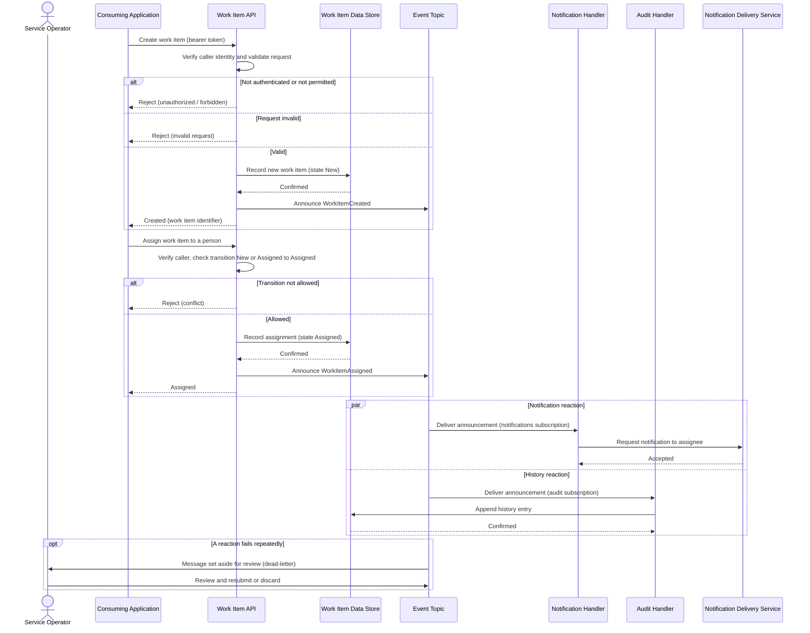

# Work Item Creation and Assignment

## Process Summary

This process records a new work item, optionally assigns it to a person, and triggers the notification and history reactions that follow; it starts when a consuming application sends a create or assign request.

It runs from the arrival of the request at the Work Item API to the completion of both asynchronous reactions (notification and history recording), involving the consuming application, the Work Item API, the event topic, the Event Processor, the work item data store, and the notification delivery service.

The critical decision point is validation of the requested lifecycle transition: an invalid transition is rejected before anything is recorded or announced, while a valid one is recorded and then announced for reaction.

## Purpose

The process gives every consuming application one consistent way to create and assign work, and ensures that each change is recorded once, announced once (at least once in practice), and reacted to without making the caller wait.

It supports the capabilities "Capture work", "Assign and hand off", "Stay informed", and "Trace history" described in the [Architecture Guide](architecture-guide.md). Boundaries and responsibilities (LR-001 to LR-004) are defined in [System Context & Logical Components](system-context.md); components (CMP-001 to CMP-006) are in [Architecture Specifications](architecture-specifications.md).

## Process Overview

A work item moves through the lifecycle states New, Assigned, InProgress, Completed, and Cancelled. This process covers the first two: creation (state New) and assignment (state Assigned). Each recorded change is announced as an event (`WorkItemCreated`, `WorkItemAssigned`); the notification and history reactions subscribe to the announcements independently.

### Process Flow Diagram

> [!NOTE]
> The diagram shows the two requests in the order a consuming application typically sends them, then the two independent reactions that follow every announcement. Only the `WorkItemAssigned` announcement results in a notification request; `WorkItemCreated` is recorded in history only (see Decision Points). The final block shows the operator path for messages that cannot be processed.

## Step-by-Step Walkthrough

### Phase 1: Create the work item

1. The consuming application sends a create request to the Work Item API, including a bearer token issued by the Identity Provider on behalf of the user.
2. The API verifies the token and checks that the caller is permitted to create work items.
3. The API validates the request content (for example, that a title is present).
4. The API records the new work item in the work item data store with the state New and a new unique identifier.
5. The API announces `WorkItemCreated` on the event topic, carrying a unique event identifier.
6. The API returns the identifier of the new work item to the consuming application.

### Phase 2: Assign the work item

1. The consuming application sends an assign request naming the work item and the assignee.
2. The API verifies the caller and loads the work item.
3. The API checks that the work item is in a state from which assignment is allowed (New or Assigned).
4. The API records the assignment and moves the state to Assigned.
5. The API announces `WorkItemAssigned` on the event topic.
6. The API confirms the assignment to the consuming application.

### Phase 3: React to the announcement

1. The event topic delivers each announcement to both subscriptions. Delivery occurs at least once, so a reaction may see the same announcement more than once.
2. The Audit Handler appends a history entry to the data store, keyed by the event identifier. If an entry with that identifier already exists, the data store rejects the duplicate and the handler treats the message as already handled.
3. The Notification Handler checks whether the announcement is of a kind that warrants a notification (`WorkItemAssigned`, `WorkItemCompleted`), and if so, checks whether it has already handled the event identifier; if not, it asks the Notification Delivery Service to notify the person concerned.
4. Each handler completes the message, which removes it from its subscription.

## Key Actors

### Consuming Application
Sends requests on behalf of its users. It never keeps its own copy of work item state and relies on the identifier and state returned by the API.

### Work Item API
Verifies callers, enforces lifecycle rules, records state, and announces changes. It does not wait for the reactions.

### Notification Handler and Audit Handler
Independent reactions to announcements. Each is safe to repeat and fails independently of the other.

### Service Operator
Monitors the service and reviews messages that could not be processed. Acts only on messages set aside after repeated failure.

## Decision Points

### Is the caller authenticated and permitted?
- **Trigger:** every incoming request.
- **Criteria:** a valid token from the Identity Provider that carries permission for the requested operation.
- **Outcomes:** continue, or reject the request without recording anything.
- **Responsible actor:** Work Item API.

### Is the requested transition valid?
- **Trigger:** any request that changes state.
- **Criteria:** the lifecycle rules for the current state (for assignment: New or Assigned).
- **Outcomes:** record and announce the change, or reject with a conflict.
- **Responsible actor:** Work Item API (LR-001).

### Does this announcement warrant a notification?
- **Trigger:** each announcement delivered to the notifications subscription.
- **Criteria:** the event type is `WorkItemAssigned` or `WorkItemCompleted`. Other announcements are never delivered to this subscription.
- **Outcomes:** request a notification, or no action.
- **Responsible actor:** Notification Handler (LR-003).

### Has this event already been handled?
- **Trigger:** each message received by a handler.
- **Criteria:** the event identifier was already processed.
- **Outcomes:** skip the work and complete the message, or process normally.
- **Responsible actor:** each handler.

## Integration Points

### Work Item Data Store (Azure Cosmos DB)
- **Purpose in this process:** holds work item records and history.
- **Data exchanged:** work item records and history entries (structures are owned by the data model, not this document).
- **Timing/frequency:** once per state change by the API; once per announcement by the Audit Handler.
- **Failure handling:** if unavailable, the API rejects the request without announcing anything; the Audit Handler retries through message redelivery.

### Event Topic
- **Purpose in this process:** carries announcements from the API to the handlers.
- **Data exchanged:** one announcement per state change with an event identifier and event type.
- **Timing/frequency:** one announcement per recorded change.
- **Failure handling:** see Error Handling.

### Notification Delivery Service
- **Purpose in this process:** delivers notification messages to people.
- **Data exchanged:** a request naming the recipient and the work item.
- **Timing/frequency:** at most once per relevant announcement, repeated only if the handler retries.
- **Failure handling:** the Notification Handler fails the message so it is redelivered.

### Identity Provider
- **Purpose in this process:** establishes who the caller is.
- **Timing/frequency:** every request.
- **Failure handling:** a request whose identity cannot be verified is rejected.

## Error Handling

### Caller not authenticated or not permitted
- **Trigger condition:** missing, expired, or insufficient token.
- **Detection method:** token verification in the API.
- **Recovery action:** none recorded; the caller obtains a valid token and retries.
- **Responsible actor:** consuming application.
- **Escalation path:** none.

### Invalid request or conflicting state
- **Trigger condition:** missing required content, or a transition not allowed from the current state.
- **Detection method:** request validation and lifecycle checks in the API.
- **Recovery action:** the request is rejected; nothing is recorded or announced.
- **Responsible actor:** consuming application.
- **Escalation path:** none.

### Data store unavailable
- **Trigger condition:** the API cannot record a change.
- **Detection method:** failed or timed-out call to the data store.
- **Recovery action:** the API rejects the request as temporarily unavailable; no announcement is made. The caller may retry.
- **Responsible actor:** consuming application; Service Operator restores service.
- **Escalation path:** Service Operator to the Platform Engineering Lead.

### Announcement could not be sent after recording a change
- **Trigger condition:** the state change was recorded but the event topic could not be reached.
- **Detection method:** failed announcement in the API, logged with the work item identifier.
- **Recovery action:** the API retries the announcement briefly and logs a failure if it still cannot send. Reliable repair of such cases is an open design decision (OI-002 in [Architecture Specifications](architecture-specifications.md)).
- **Responsible actor:** Work Item API; Service Operator for follow-up.
- **Escalation path:** Lead Architect (design decision).

### A reaction fails repeatedly
- **Trigger condition:** a handler fails the same message on every delivery attempt.
- **Detection method:** the message reaches the maximum delivery count and is set aside in the dead-letter area.
- **Recovery action:** the Service Operator reviews the message, corrects the cause, and resubmits or discards it. The original state change is unaffected.
- **Responsible actor:** Service Operator.
- **Escalation path:** Platform Engineering Lead.

## Related Documents

- [Architecture Guide](architecture-guide.md)
- [System Context & Logical Components](system-context.md)
- [Architecture Specifications](architecture-specifications.md)
- [Infrastructure Architecture Guide](infrastructure-architecture-guide.md)
- [Executive Summary](executive-summary.md)
