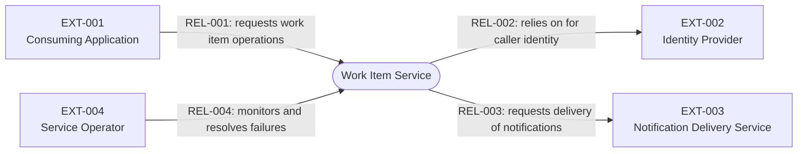
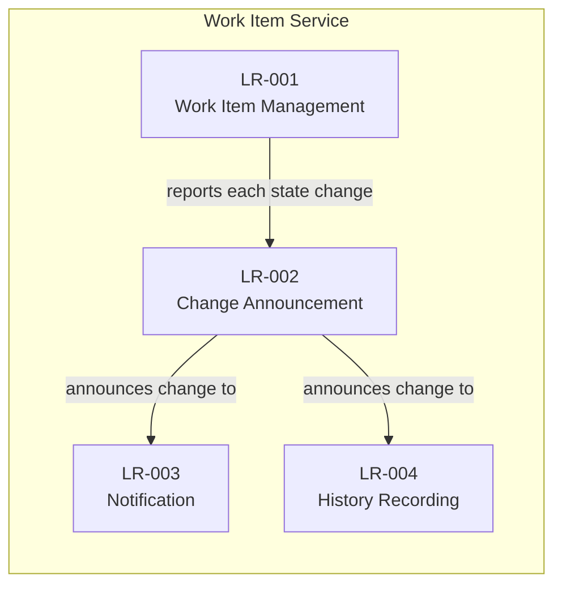

# Work Item Service System Context & Logical Components

## Document Control and View Definitions

**Status:** Approved

**Authoritative owner:** Lead Architect

**Last reconciled:** 2026-10-11 (Phase 4, revision 1.1)

| View | Scope | Intended audience | Concerns addressed | Abstraction level | Notation / model kind |
|---|---|---|---|---|---|
| System Context View | The Work Item Service and its directly interacting environment | Business and architecture stakeholders | System boundary, external actors and systems, logical interaction purposes | Black box; no internal design | Mermaid flowchart; context model |
| Logical Responsibility View | The high-level responsibility areas inside the Work Item Service | Architects, developers, technical leads, and other design readers | Conceptual responsibilities and their logical relationships | White box; implementation-neutral | Mermaid flowchart; responsibility model |

## Purpose and System of Interest

**System of interest:** Work Item Service (WIS), described in the [Architecture Guide](architecture-guide.md).

**Role:** WIS is the single authoritative place where Momentum Rocket Skates applications create, assign, and track work items, and it reacts to changes by notifying people and recording history.

**Boundary:** Inside the boundary are the rules that govern work item state, the durable keeping of work item records and history, the announcement of changes, and the reactions to those changes (notifications and audit history). Outside the boundary are the applications that call the service, identity management, and the delivery of notification messages to people. The Work Item Service does not include a user interface.

**Decomposition principle:** Responsibilities are separated by durable reason to change: deciding the state of work (LR-001), announcing that state changed (LR-002), and reacting to changes, which are split by kind of outcome (LR-003, LR-004).

## System Context View

### Context Diagram

**Legend:** Rectangles are external actors or systems. The rounded shape is the system of interest. An arrow shows the direction in which the interaction is initiated; a double-headed arrow means both parties exchange information. Labels give the logical purpose only and imply no protocol, schema, or delivery guarantee.

### External Actors and Systems

| ID | Actor or system | Element type | Role in relation to the system of interest | Optional classification | Authoritative reference |
|---|---|---|---|---|---|
| EXT-001 | Consuming Application | External system | A Momentum Rocket Skates application that works with work items on behalf of its users | Consumer | [Architecture Specifications](architecture-specifications.md) (INT-001) |
| EXT-002 | Identity Provider (Microsoft Entra ID) | External system | Establishes who a caller is | Peer | [Architecture Specifications](architecture-specifications.md) (INT-010) |
| EXT-003 | Notification Delivery Service | External system | Delivers notification messages to people | Consumer | [Architecture Specifications](architecture-specifications.md) (INT-008; OI-004) |
| EXT-004 | Service Operator | Human role | Monitors the service and resolves failed reactions | n/a | [Process Flow](process-flow-work-item-creation-and-assignment.md) (Error Handling) |

### External Relationship Inventory

| ID | From | To | Direction / cardinality | Logical interaction purpose | Authoritative detail |
|---|---|---|---|---|---|
| REL-001 | EXT-001 | Work Item Service | Directed; many applications to one service | Ask the service to create, read, assign, and update work items | [Architecture Specifications](architecture-specifications.md) (INT-001) |
| REL-002 | Work Item Service | EXT-002 | Directed | Rely on the provider to establish the identity of callers | [Architecture Specifications](architecture-specifications.md) (INT-010, OBL-001) |
| REL-003 | Work Item Service | EXT-003 | Directed | Request that a notification be delivered to a person | [Architecture Specifications](architecture-specifications.md) (INT-008) |
| REL-004 | EXT-004 | Work Item Service | Directed | Observe health and resolve failed reactions | [Process Flow](process-flow-work-item-creation-and-assignment.md) (Error Handling) |

## Logical Responsibility View

### Logical Responsibility Diagram

**Legend:** Each box is a durable, implementation-neutral responsibility area. An arrow means the source responsibility provides information the target responsibility acts on. The view does not imply deployable units, teams, or runtime sequence.

### Responsibility Inventory

| ID | Logical responsibility | Owns (conceptual accountability) | Does not own | Collaborates with / key logical relationships | Corresponding detailed elements and authoritative detail |
|---|---|---|---|---|---|
| LR-001 | Work Item Management | The definition of a work item, its lifecycle states, and the rules for moving between them; the decision that a change is valid; the durable keeping of work item state | Announcing changes, notification, history, storage technology, caller identity | Reports each valid state change to LR-002 | [Architecture Specifications](architecture-specifications.md): CMP-001, CMP-002, CMP-003, DS-001 |
| LR-002 | Change Announcement | Making each recorded state change known, once it is recorded, to anyone interested | Deciding whether a change is valid; what reactions do | Receives from LR-001; informs LR-003 and LR-004 | [Architecture Specifications](architecture-specifications.md): CMP-004 |
| LR-003 | Notification | Deciding which announced changes warrant telling a person, and requesting delivery | Message delivery itself; state of work items | Reacts to LR-002 | [Architecture Specifications](architecture-specifications.md): CMP-005 |
| LR-004 | History Recording | Keeping an ordered, durable record of every announced change | Interpretation or reporting of history; state of work items | Reacts to LR-002 | [Architecture Specifications](architecture-specifications.md): CMP-006, DS-001 |

Cross-cutting concerns such as identity and observability are not shown as responsibilities. Their authoritative treatment is in the [Architecture Specifications](architecture-specifications.md) (OBL-001, OBL-007) and the [Infrastructure Architecture Guide](infrastructure-architecture-guide.md).

## Correspondences and Authoritative References

| System Context ID | Related concept or responsibility ID | Authoritative document and location | Correspondence | Status / disposition |
|---|---|---|---|---|
| LR-001 | CMP-001, CMP-002, CMP-003, DS-001 | [Architecture Specifications](architecture-specifications.md), Component Decomposition | 1:many | Verified (Phase 2) |
| LR-002 | CMP-004 | [Architecture Specifications](architecture-specifications.md), Component Decomposition | 1:1 | Verified (Phase 2); reliability pattern open (OI-002) |
| LR-003 | CMP-005 | [Architecture Specifications](architecture-specifications.md), Component Decomposition | 1:1 | Verified (Phase 2) |
| LR-004 | CMP-006, DS-001 | [Architecture Specifications](architecture-specifications.md), Component Decomposition | 1:many | Verified (Phase 2) |
| REL-001 to REL-004 | INT-001, INT-008, INT-010, INT-014 | [Architecture Specifications](architecture-specifications.md), Interaction and Dependency Inventory | Partial; reference only | Verified (Phase 2) |
| LR-001 to LR-004 | Logical flow | [Process Flow](process-flow-work-item-creation-and-assignment.md) | Reference only | Verified (Phase 2) |
| EXT-001 to EXT-004 | Deployment relationships | [Infrastructure Architecture Guide](infrastructure-architecture-guide.md), sections 5.1 and 5.4 | Partial; external elements are not provisioned here | Verified (Phase 3) |

## Open Items

| ID | Question / mismatch | Owner role | Resolution target phase | Status / disposition |
|---|---|---|---|---|
| OI-004 | Interface to the Notification Delivery Service (EXT-003) | Integration Lead | Phase 5; tracked in [Architecture Specifications](architecture-specifications.md) | Open |

## Change Triggers and Review Record

Review this document when the system boundary, external actors or systems, logical responsibilities, their relationships, or authoritative correspondences change.

| Date | Review trigger / phase | Views and correspondences checked | Mismatches and disposition | Reviewer role |
|---|---|---|---|---|
| 2026-09-14 | Phase 1 creation | Both views | None identified | Lead Architect |
| 2026-09-28 | Phase 2 reconciliation | Responsibilities against components, interactions against flows | None identified | Lead Architect |
| 2026-10-09 | Phase 3 reconciliation | External relationships against infrastructure relationships | None identified; open items tracked above | Lead Architect |
| 2026-10-11 | Change: work item data store brought inside the boundary | Both views, correspondences, and ID numbering | None identified; external actor, relationship, and open-item IDs renumbered | Lead Architect |
| 2026-10-11 | Phase 4 readiness | All views and correspondences | None identified; open items dispositioned with owner and target | Lead Architect |
